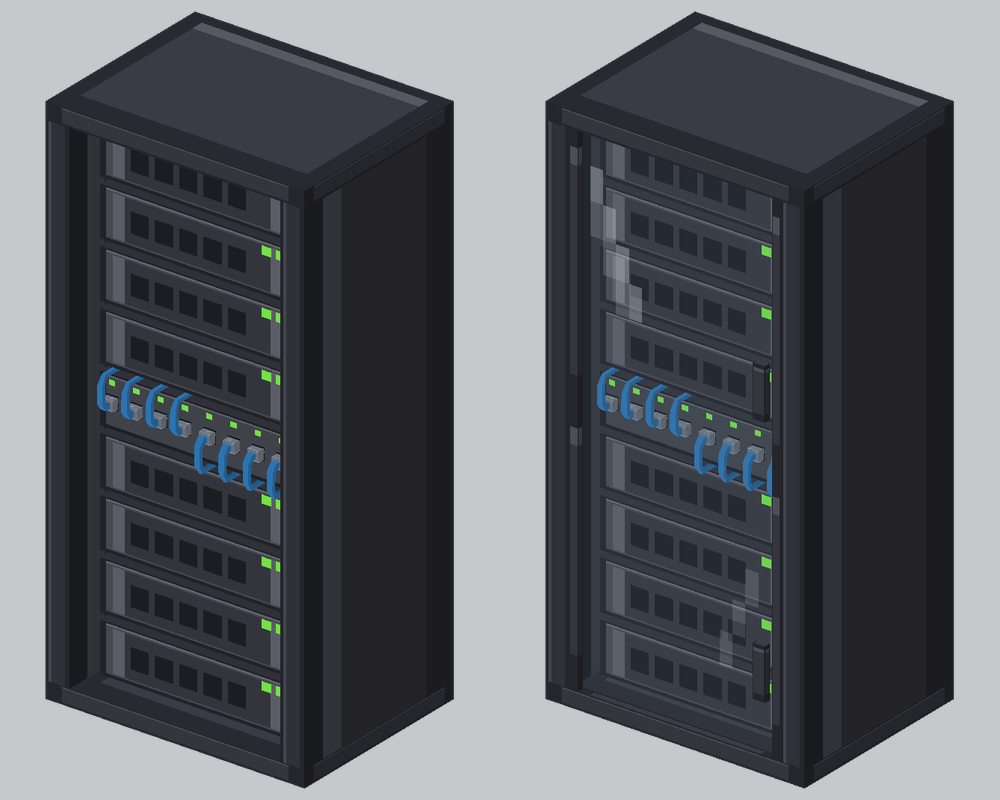
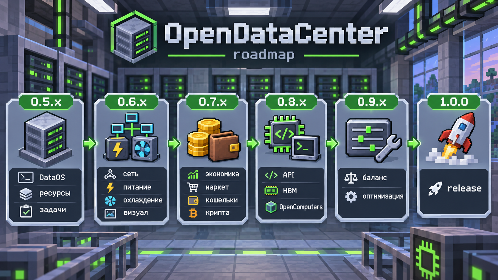

# OpenDataCenter

**Постройте свой дата-центр в Minecraft · Build your own data center in Minecraft**

`Minecraft 1.12.2` · `Forge 14.23.5.2860` · `0.6.1.15-alpha`

[Русский](#русский) · [English](#english) · [Дорожная карта](#дорожная-карта) · [Roadmap](#roadmap)

## Русский

**OpenDataCenter** — мод для Minecraft Forge, в котором вы собираете серверы из отдельных комплектующих, размещаете их в стойках и соединяете в сеть. Через терминал **DataOS** вы управляете вычислительными пулами, распределяете ресурсы и зарабатываете игровую валюту на контрактах.

### Что уже есть

- **Серверное оборудование.** Стойки 4U и 9U, сборка серверов на верстаке, выбор CPU, GPU, памяти и накопителей.
- **DataOS.** Обзор инфраструктуры, карточки серверов, журнал событий и сводка по ресурсам и кошельку.
- **Задачи и контракты.** Постоянные вычисления, контракты и периодические услуги. Для задачи можно выбрать пул и закрепить конкретные комплектующие за её резервом.
- **Сетевая инфраструктура.** LAN и оптика, антенны, сетевые терминалы и стоечные коммутаторы. На интерактивной карте можно менять uplink-подключения и смотреть маршруты WAN и ограничения пропускной способности.

### Версия 0.6.1.15-alpha

Стеклянные стойки 4U и 9U имеют анимированную дверцу: ПКМ по стеклу открывает или закрывает её; доступ к оборудованию возможен только после открытия. Отключённые от коммутатора серверы исключаются из пулов и ресурсов DataOS, сохраняя своё назначение до повторного подключения. Материнские платы со встроенным NIC показывают его скорость в подсказке; иконки коммутаторов в инвентаре уменьшены на 20%. При отдалении сетевой карты используются компактные карточки и чёткие линии, а обзор DataOS показывает статистику без кнопок. У радиоантенны, спутниковой тарелки и вышки больше нет собственных окон: их характеристики доступны на карте сетевого терминала. Без питания терминалы DataOS и Network показывают чёрный экран в пределах своего стандартного окна. Сервер проверяет действия на терминалах. В подсказках сетевых терминалов указана номинальная пропускная способность, а вкладка «Серверы» в DataOS показывает только серверы, подключённые к коммутатору. [Каталог коммутаторов 0.6.1.8](docs/SWITCH_CATALOGUE_0618.md) · [Журнал изменений](CHANGELOG.md)

### Сборка и запуск

Для сборки нужен **JDK 8**. В корне репозитория запустите подходящую команду.

| Система | Команда |
| --- | --- |
| Windows | `.\build.bat` |
| Linux / macOS | `bash build.sh` |

После успешной сборки JAR появится в `build/libs/`. Поместите его в папку `mods` профиля **Minecraft 1.12.2** с **Forge 14.23.5.2860**. Для первого запуска рекомендуется новый мир.

### Дорожная карта

| Версия | Этап | Статус |
| --- | --- | --- |
| **0.5.x** | DataOS, вычислительные пулы, задачи, журнал и сводка по кошельку | В исходниках |
| **0.6.1.x** | Физическая и логическая сеть, расчёт полосы, интерактивная карта, интеграция WAN с задачами и новые коммутаторы | В исходниках · игровая проверка впереди |
| **0.6.2** | Энергосети, батареи, блоки питания, расчёт расхода и вкладка «Питание» | Следующий этап |
| **0.6.3–0.6.4** | Охлаждение, перегрев и троттлинг, доработка моделей и индикаторов | Запланировано |
| **0.7.x** | Игровые счета и организации, ноутбук с магазином, валютная биржа и баланс выживания | Запланировано |
| **0.8.x** | Публичный API и конфигурация, интеграции с энергетическими модами и OpenComputers | Запланировано |
| **0.9.x–1.0.0** | Стабилизация, многопользовательская игра, производительность, документация и выпуск | Запланировано |

Номера будущих версий предварительные. [Полная дорожная карта](OpenDataCenter-ROADMAP-FULL.md) · [Чек-лист задач](OpenDataCenter-ROADMAP-CHECKLIST.md)

[Архитектура](docs/ARCHITECTURE.md) · [Интеграция WAN](docs/NETWORK_INTEGRATION_0617.md) · [Сценарии проверки задач](docs/TASKS_MANUAL_CHECK.md) · [Чек-лист сборочного верстака](docs/WORKBENCH_MANUAL_CHECK.md)

---

## English

**OpenDataCenter** is a Minecraft Forge mod where you assemble servers from individual components, mount them in racks, and connect them to a network. Use the **DataOS** terminal to manage compute pools, allocate resources, and earn in-game currency by completing contracts.

### What's available

- **Server hardware.** Build servers at a workbench with your choice of CPUs, GPUs, memory, and drives, then mount them in 4U or 9U racks.
- **DataOS.** View infrastructure, inspect individual servers, browse the event log, and check resource usage and wallet balances.
- **Jobs and contracts.** Run continuous workloads, contracts, and recurring services. Choose a compute pool and reserve specific hardware for a job.
- **Networking.** Build with LAN and fiber links, antennas, network terminals, and rack switches. Use the interactive map to edit uplinks and inspect WAN routes and bandwidth bottlenecks.

### Version 0.6.1.15-alpha

Glass racks (4U and 9U) have an animated door: right-click the glass to open or close it; local hardware access requires the door to be fully open. Servers unplugged from their switch are excluded from pools and resource totals until reconnected, retaining their assigned pool. Motherboards with onboard NICs show their speed in tooltips; switch inventory icons are 20% smaller. Zoomed-out network maps use compact cards and crisp links; the DataOS overview shows read-only statistics. Radio antennas, satellite dishes and telecom towers no longer open their own GUIs; their status is available on the network terminal map. DataOS and Network terminals show a black screen within their normal window bounds when unpowered. The server validates terminal actions. Network terminal tooltips show rated bandwidth, and the DataOS Servers tab lists only servers connected to a switch. [0.6.1.8 switch catalogue](docs/SWITCH_CATALOGUE_0618.md) · [Changelog](CHANGELOG.md)

### Build and run

Building requires **JDK 8**. Run the command for your platform from the repository root.

| Platform | Command |
| --- | --- |
| Windows | `.\build.bat` |
| Linux / macOS | `bash build.sh` |

After a successful build, find the JAR in `build/libs/`. Place it in the `mods` folder of a **Minecraft 1.12.2** profile running **Forge 14.23.5.2860**. A new world is recommended for the first launch.

### Roadmap

| Version | Milestone | Status |
| --- | --- | --- |
| **0.5.x** | DataOS, compute pools, jobs, event log, and wallet overview | In source |
| **0.6.1.x** | Physical and logical networking, bandwidth allocation, interactive network map, WAN integration for jobs, and new switches | In source · in-game verification pending |
| **0.6.2** | Power networks, batteries, power supplies, consumption tracking, and the Power tab | Up next |
| **0.6.3–0.6.4** | Cooling, overheating and throttling, and visual refinements | Planned |
| **0.7.x** | In-game accounts and organizations, a laptop marketplace, currency exchange, and survival balancing | Planned |
| **0.8.x** | Public API and configuration, energy-mod integrations, and OpenComputers support | Planned |
| **0.9.x–1.0.0** | Stabilization, multiplayer, performance, documentation, and release | Planned |

Future version numbers are provisional. [Illustrated roadmap](docs/roadmap.png) · [Full roadmap in Russian](OpenDataCenter-ROADMAP-FULL.md) · [Development checklist in Russian](OpenDataCenter-ROADMAP-CHECKLIST.md)

[Architecture](docs/ARCHITECTURE.md) · [WAN integration](docs/NETWORK_INTEGRATION_0617.md) · [Job verification scenarios](docs/TASKS_MANUAL_CHECK.md) · [Workbench verification checklist](docs/WORKBENCH_MANUAL_CHECK.md)
