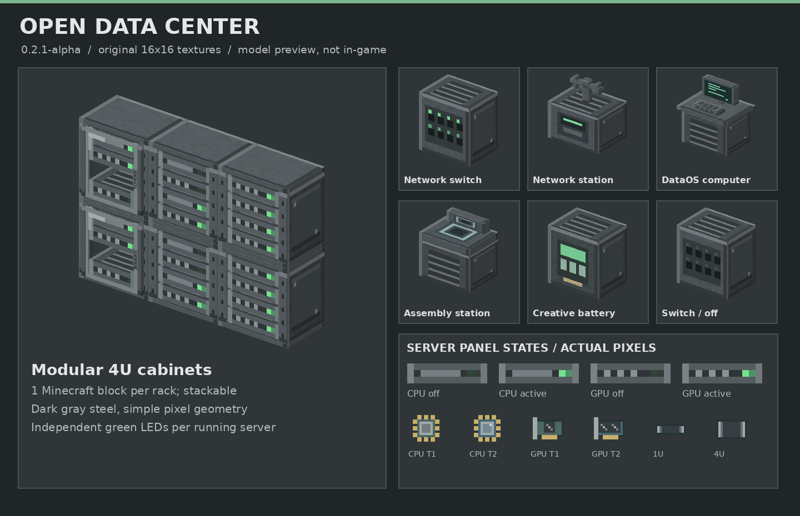

# OpenDataCenter 0.2.1-alpha

**Minecraft 1.12.2 · Forge 14.23.5.2860 · JDK 8 · самостоятельный мод**

OpenDataCenter моделирует промышленную IT-инфраструктуру: собираемые серверы, стойки, независимые вычислительные задачи, питание, локальную сеть, глобальный uplink, игровую валюту NTC и магазин. Не требует OpenComputers, HBM, Ender IO или других модов. Собственной генерации энергии нет: для испытаний предусмотрен творческий источник. Все вычисления и сетевые ресурсы симулируются внутри Minecraft; настоящего майнинга, интернета или AI-моделей нет.

**Статус релиза:** проверены независимое вычислительное ядро, алгоритмы раскладки стоек и обхода сети, Java-синтаксис и все ресурсы. Полная компиляция с Forge и запуск игры в среде разработки не выполнены: доступна Java 21, нет JDK 8 и DNS-доступа к Maven Forge. Это архив исходников, а не готовый JAR. Возможны несовместимости API, загрузки ресурсов или GUI, которые выявятся при первом реальном запуске. См. `docs/TEST_REPORT.md`.



Предпросмотр выполнен офлайн из действительных JSON-моделей, UV и текстур проекта; это не скриншот из игры.

## 1. Новое в 0.2.1 — сборка и обслуживание

- Сервер теперь имеет собственный инвентарь реальных ItemStack: материнская плата, CPU, четыре возможных RAM, два накопителя, четыре GPU. Ограничения корпуса и платы действуют одновременно.
- Для запуска обязательны плата, CPU, хотя бы одна RAM и хотя бы один HDD/SSD. GPU необязательны, но нужны для майнинга и AI. Характеристики CPU/GPU и правила задач из 0.2.0 сохранены.
- Собери пустой корпус в Assembly Station либо сразу укомплектуй его. Установи предмет сервера в стойку; нажми «Детали» напротив первого юнита конкретной машины. В этом GUI можно добавлять, извлекать и заменять детали как в обычном инвентаре Minecraft. Кнопка «Назад» возвращает в стойку. Сервер на время обслуживания приостановлен; после закрытия GUI планировщик продолжает его прежнюю задачу, если конфигурация полная и хватает энергии/сети.
- Детали хранятся внутри NBT предмета сервера, а не в общем инвентаре стойки. При переносе между стойками они остаются внутри корпуса. Одновременное редактирование одного сервера блокируется. Снижение ёмкости платы может оставить ранее установленные детали в недоступных слотах: их можно извлечь, но до этого машина не запустится. Детали не удаляются автоматически.
- Новые предметы: Basic/Pro Motherboard, RAM 4/16 GB, HDD 128 GB, SSD 512 GB. Номинальные скорости RAM 1600/3200 MHz показаны в подсказках; память и диски пока только обязательные ресурсы с отображением ёмкости. Их скорость, энергопотребление и влияние на задачи будут реализованы позже.

| Корпус | Максимум RAM | Максимум накопителей | Максимум GPU |
|---|---:|---:|---:|
| 1U | 2 | 1 | 1 |
| 2U | 2 | 2 | 2 |
| 4U | 4 | 2 | 4 |

Базовая плата ограничивает эти значения до 2 RAM, 1 диска, 1 GPU. Продвинутая поддерживает все слоты корпуса. CPU и плата — по одной штуке для любой конфигурации. Отдельные NIC, PSU и охлаждение пока не требуются.

**Обновление мира 0.2.0:** предварительно сделай резервную копию. Старые корпуса, CPU и GPU распознаются по прежним NBT-полям; при первом изменении конфигурация записывается в новый формат. Новые обязательные детали не выдаются бесплатно — их необходимо добавить. Старые станки сохраняют номера своих первоначальных слотов. Миграция предусмотрена в коде, но не проверена в игре. Не загружай обновлённый мир обратно в старую версию.

### Что ранее изменилось с 0.1.0

- **Независимые задачи:** майнинг, банковские вычисления, AI. Задачи включаются/выключаются в DataOS, физические серверы присоединяются к ним отдельно. Несколько серверов и стоек могут обслуживать одну задачу.
- **Пропускная способность:** Network Station (антенна) даёт WAN, Network Switch (коммутатор) — LAN. Оба устройства потребляют энергию. Все задачи делят один бюджет сети. При недостатке сети или питания работа ограничивается, награда уменьшается. Отключённый коммутатор разрывает путь через себя.
- **Управление:** диспетчер задач с фактической/требуемой полосой, количеством активных/назначенных серверов, производительностью и доходом; отдельный интерфейс магазина; назначение задачи на каждый сервер в стойке; привязка стойки к контроллеру. Интерфейсы переведены на русский и английский.
- **Графика:** исходные текстуры упрощены до 16×16 пикселей, геометрия блоков упрощена. Каждый установленный сервер имеет отдельное состояние зелёных LED. Активный индикатор питания постоянный, второй индикатор активности мягко мигает через `.png.mcmeta`. Эмиссивного освещения в темноте пока нет. Включённый компьютер и сетевые блоки имеют отдельные модели состояния.
- **Качество:** вычислительное ядро выделено из Minecraft-зависимого кода; добавлены автоматические тесты, в том числе 12 000 случайных сценариев. Баланс NTC начисляется только после списания энергии. Сеть считается один раз на физический домен, а не отдельно на каждый контроллер.

## 2. Сборка на Windows

1. Установи **JDK 8 x64** (не JRE), например Eclipse Temurin 8: https://adoptium.net/temurin/releases/?version=8 .
2. Распакуй ZIP в обычную папку. Открой PowerShell в папке `OpenDataCenter-0.2.1-alpha`.
3. Укажи реальный путь к JDK 8 (если Java 8 уже используется по умолчанию, переменная не обязательна):
   ```powershell
   $env:JAVA_HOME = 'C:\Program Files\Eclipse Adoptium\jdk-8.0.XXX.X-hotspot'
   .\build.bat
   ```
   Скрипт проверит Java 8, скачает официальный Forge MDK, скопирует Gradle Wrapper и запустит `gradlew build`. При сборке выполняются регрессионные тесты ядра. Нужен интернет к Forge/Maven/Gradle/Mojang.
4. После успешной сборки помести `build\libs\OpenDataCenter-1.12.2-0.2.1-alpha.jar` в `mods` профиля Minecraft 1.12.2 Forge 14.23.5.2860. ZIP и исходники в `mods` класть не нужно. Удали предыдущий JAR ODC, если он есть.
5. Для dev-клиента прямо из проекта: ` .\build.bat -RunClient `. Для выделенного dev-сервера: ` .\build.bat -RunServer ` (возможно, потребуется принятие Minecraft EULA в `run-server/eula.txt`).

Без Forge можно быстро проверить ядро на JDK 8 или современной JDK:
```powershell
.\test-core.bat
```

Если автоматическая загрузка MDK недоступна, скачай официальный MDK вручную с https://files.minecraftforge.net/net/minecraftforge/forge/index_1.12.2.html (14.23.5.2860), скопируй **только** `gradlew`, `gradlew.bat` и `gradle/wrapper` в папку проекта и снова запусти сборку. Не заменяй `build.gradle`. Если не проходит Gradle, приложи полный текст ошибки и вывод `java -version`.

Linux/WSL: установи JDK 8, `curl`, `unzip`; `bash build.sh` (сборка), `bash build.sh runClient` (клиент), `bash build.sh runServer` (сервер). `bash tools/test-core.sh` — тесты без Forge. В архиве также есть необязательный GitHub Actions workflow для сборки после помещения проекта в собственный GitHub-репозиторий; в этой среде он не запускался.

## 3. Быстрый старт (первый тест — новый творческий мир)

Все блоки, корпуса и комплектующие находятся во вкладке «Механизмы» / Redstone. Готовый сервер получается только при сборке в станке.

**Шаг 1.** Поставь `Server Assembly Station`. Собери три сервера и забери их из OUTPUT (станок не требует питания). Для каждого установи Basic Motherboard, RAM 4 GB и HDD 128 GB в соответствующие слоты (либо добавь их уже через GUI стойки):

| Сервер | Корпус | CPU | GPU | Задача |
|---|---|---|---|---|
| A | 1U | CPU T2 | GPU T2 | Майнинг |
| B | 1U | CPU T2 | нет | Банк |
| C | 1U | CPU T2 | GPU T2 | AI |

GPU T1 можно использовать для майнинга, но не для AI. Вместо 1U разрешены 2U и 4U (до 2 или 4 ускорителей с продвинутой платой соответственно).

**Шаг 2.** Поставь открытую или стеклянную стойку. Вставь три собранных сервера в отдельные свободные слоты. 2U требует два последовательных слота, 4U — все четыре. Стойка сама занимает один блок мира; можно ставить стойки друг на друга.

**Шаг 2a.** Проверь «Детали» у каждого сервера, убедись, что отображается «Комплектующие готовы». Можно извлечь или добавить компоненты.

**Шаг 3.** Поставь компьютер DataOS, коммутатор Network Switch, сетевую станцию Network Station и Creative Energy Source. Соедини их и стойку сетевыми кабелями (Data Cable), например так:

```text
ВИД СВЕРХУ — DATA CABLE:

[ DataOS ]--D--[ Switch ]--D--[ Station ]
                   |
                   D
                   |
                 [ Rack ]

POWER CABLE — отдельный слой, например под полом:

  DataOS       Switch       Station       Rack
     |            |             |            |
     P------------P-------------P------------P
                  |
          [ Creative Energy Source ]
```

D = сетевой кабель; P = силовой. Кабели соединяются по общим граням, не по диагонали. Не нужно пытаться использовать один блок одновременно как D и P. Питание должно подойти к каждому из четырёх устройств; аккумулятор напрямую рядом с устройством также работает. Станция не подключается к реальному интернету. В сети нет автоматической генерации валюты без вычислительной задачи.

**Шаг 4.** Подожди несколько игровых тиков после подключения питания. ПКМ по стойке. Нажми «Выбрать ПК», чтобы связать её с DataOS (либо при первом назначении задачи автоматически выбирается первый доступный компьютер того же владельца). Кнопка выбора перебирает доступные компьютеры и состояние «нет контроллера»; смена привязки сбрасывает назначения. Кнопка напротив каждого установленного сервера циклически переключает `Простой → Майнинг → Банк → ИИ → Простой`. Выбери три разные задачи.

**Шаг 5.** ПКМ по DataOS. Запусти все три задачи кнопками «Пуск». Через один игровой расчётный цикл (~20 тиков) индикаторы соответствующих серверов должны загореться, а в окне появятся фактическая производительность, `занято/требуется Mb/s` и доход NTC/s.

**Шаг 6.** Посмотри на сетевой лимит. С одной станцией и одним коммутатором WAN=128, LAN=64 Mb/s. Три приведённых сервера требуют суммарно 4+16+64=84 Mb/s, поэтому они ограничены пропускной способностью. Добавь ещё один запитанный коммутатор в ту же сеть: LAN=128, и задачи смогут работать на полную мощность. Вторая станция нужна, когда WAN становится узким местом.

**Шаг 7.** Открой «Магазин» из DataOS. При достаточном балансе и месте в инвентаре купи ресурсы. Перезайди в мир и проверь сохранение содержимого, выбранных задач, включённых задач, привязки и баланса. При разрыве data cable между стойкой и компьютером работа прекратится не позднее следующего расчётного цикла (при отсутствии альтернативного пути).

## 4. Сеть и распределение вычислений

Глобальный WAN формируется из запитанных станций (по 128 Mb/s). LAN формируется из запитанных коммутаторов (по 64 Mb/s). Эффективная ёмкость одного подключённого домена:

```
capacity = min(sum(online stations), sum(online switches))
```

Все серверы и контроллеры одного владельца в физически связанном домене используют **одну** ёмкость, независимо от числа управляющих ПК. Это приближённая модель общей коммутационной шины: кабели и ODC-устройства, соединённые гранями, формируют домен; выключенный коммутатор не пропускает путь через себя. Нет индивидуальных портов, IP-адресов, задержек, маршрутизации пакетов, QoS или ограничений по отдельному сегменту кабеля. Параллельные коммутаторы суммируют ёмкость в домене. Сетевые ресурсы разных владельцев учитываются раздельно; доступ к оборудованию ограничен владельцем (творческий игрок имеет служебный доступ). Это не полноценная система защиты территорий.

Планировщик выполняется на стороне игрового сервера каждые 20 игровых тиков. Для каждой задачи сервер предоставляет свой профиль вычислений. Сначала рассчитывается, сколько работы можно оплатить энергией стойки, затем распределяется общая сеть пропорционально запросам с целочисленными долями и вращающимся разрешением ничьих. Если сеть ограничена, реальная работа, потребление и награда уменьшаются пропорционально выданной полосе. Списание FE производится до начисления NTC. Сервер без подходящего оборудования, связи, питания или включённой задачи не получает доход.

В этой версии одна физическая машина может обслуживать одну задачу за цикл. Один контроллер имеет три постоянные независимые задачи (по одному экземпляру каждого типа); произвольные пользовательские контракты и деление одной машины между несколькими задачами запланированы позднее. Смена назначения не уничтожает оборудование. Удаление/замена сервера сбрасывает назначение его слота.

## 5. Предварительный баланс

| Компонент | CPU CU/s | Mining H/s | VRAM | Пиковая мощность |
|---|---:|---:|---:|---:|
| CPU T1 | 40 | — | — | 8 FE/t |
| CPU T2 | 160 | — | — | 20 FE/t |
| GPU T1 | — | 40 | 4 GB | 25 FE/t |
| GPU T2 | — | 160 | 16 GB | 85 FE/t |

| Задача | Полная сетевая потребность | Награда при полной работе по умолчанию |
|---|---|---|
| Майнинг | 1 Mb/s на 40 H/s | 0.001 NTC/s на 1 H/s |
| Банковские вычисления | 1 Mb/s на 10 CPU CU/s | 0.001 NTC/s на 1 CPU CU/s |
| AI | 4 Mb/s на 1 GB подходящей VRAM | 0.015 NTC/s на 1 GB подходящей VRAM |

AI требует минимум 8 GB **на отдельной видеокарте**, а не просто сумму памяти разных слабых карт. Поэтому GPU T1 (4 GB) не участвует в AI, GPU T2 (16 GB) участвует; несколько GPU T2 дают больше работы. При троттлинге показатель `GB-eq` в DataOS — эффективный эквивалент AI-производительности, а не изменение физического объёма VRAM. Фактическую VRAM можно посмотреть во всплывающей подсказке сервера.

CPU-only сервер может выполнять банк; в майнинге CPU обеспечивает только управление, не хешрейт. Неиспользуемые GPU не расходуют пиковую мощность при банковских задачах. Полное потребление задачи = 8 FE/t базовой нагрузки + профиль CPU + задействованные GPU. Базовое потребление управляющего ПК 5 FE/t, коммутатора 8 FE/t, станции 12 FE/t. При `requireEnergy=false` проверка FE отключается; это тестовый/настраиваемый режим, не дополнительный генератор.

Буфер стойки 12 000 FE (достаточно для любого поддерживаемого 20-тикового пакета работы), буферы сетевых устройств и ПК — 480 FE. После удаления питания оборудование выключается при исчерпании буфера, а не обязательно мгновенно. Сетевые разрывы влияют на расчёт сразу на следующем цикле. На низких TPS награда начисляется по игровым тикам, а не по реальным секундам.

Все цифры — первоначальный баланс, а не окончательные характеристики реальных устройств.

## 6. Настройки и магазин

После первого запуска создаются `config/odc.cfg` и `config/odc-market.json`. Настройки меняются до запуска, затем требуется перезапуск. По умолчанию:

- `energy.requireEnergy = true`, `energy.creativeBatteryOutput = 50000` FE/t;
- `network.stationMbps = 128`, `network.switchMbps = 64`;
- `mining.rewardDivisor = 20` (больше значение — меньше доход майнинга);
- `tasks.bankRewardMilliPerCU = 1`, `tasks.aiRewardMilliPerGB = 15`.

В `odc-market.json` поддерживается до четырёх предложений (текущая вместимость GUI). Пример:
```json
[
  {"item":"minecraft:iron_ingot","count":16,"priceMilli":5000},
  {"item":"minecraft:gold_ingot","count":8,"priceMilli":10000},
  {"item":"minecraft:diamond","count":1,"priceMilli":40000},
  {"item":"odc:precision_chip","count":1,"priceMilli":25000}
]
```
`priceMilli` — тысячные доли NTC, 5000 = 5 NTC. Можно указывать registry ID предметов других модов, если они загружены. Неподдерживаемый предмет не продаётся; пока нет метаданных/NBT, страниц каталога и GUI редактора. Все рецепты сразу доступны; более дорогие комплектующие используют Precision Chip из магазина. Баланс хранится в WorldSavedData в milli-NTC, максимум 2 147 483.647 NTC на кошелёк. Вся экономика проверяется сервером.

## 7. Обновление старого мира

Не удалялись прежние registry ID блоков, предметов и TileEntity. Формат собранного сервера сохранён. Старые серверы и баланс должны сохраниться, но старый флаг автоматического майнинга намеренно не используется: потребуется подключить сетевую станцию и коммутатор, заново привязать стойку и назначить задачи. Старые энергетические буферы ограничиваются новой вместимостью. Миграция не проверена в запущенном Minecraft — **сделай резервную копию мира** и сначала протестируй 0.2 в новом мире.

## 8. Структура проекта и дальнейшая разработка

- `src/main/java/odc/ComputeEngine.java` — независимые профили и планировщик ресурсов;
- `RackLayout.java`, `TopologySearch.java` — чистые алгоритмы;
- `ClusterScheduler.java`, `Network.java` — серверный расчёт и физическая топология;
- `Tiles.java`, `Hardware.java`, `Blocks.java` — оборудование, NBT, энергия, состояния блоков;
- `Menus.java`, `Client.java` — GUI, серверные проверки и синхронизация;
- `Market.java`, `ODC.java` — экономика, конфигурация, регистрация;
- `src/main/resources/assets/odc` — модели, локализация, рецепты, текстуры;
- `tools/generate_assets.py`, `tools/preview.py` — воспроизводимая генерация/предпросмотр (Python Pillow, для preview также NumPy);
- `tools/validate_assets.py` — проверка ресурсов без сторонних библиотек Python;
- `src/test/java/odc/ComputeEngineTest.java` — независимые регрессионные тесты;
- `docs/ARCHITECTURE.md`, `docs/TEST_REPORT.md` — документация для разработки и проверки.

За рамками 0.2: ASIC, охлаждение, реальная ОС с установочным носителем, графический редактор настроек/магазина, произвольные контракты, совместимость с OpenComputers/HBM, расширенная маршрутизация и профилирование больших серверов. Сохранена Forge Energy capability для приёма энергии, но внешние моды и кабели не тестировались. Силовой кабель в 0.2 — внутренняя сеть творческого источника.
