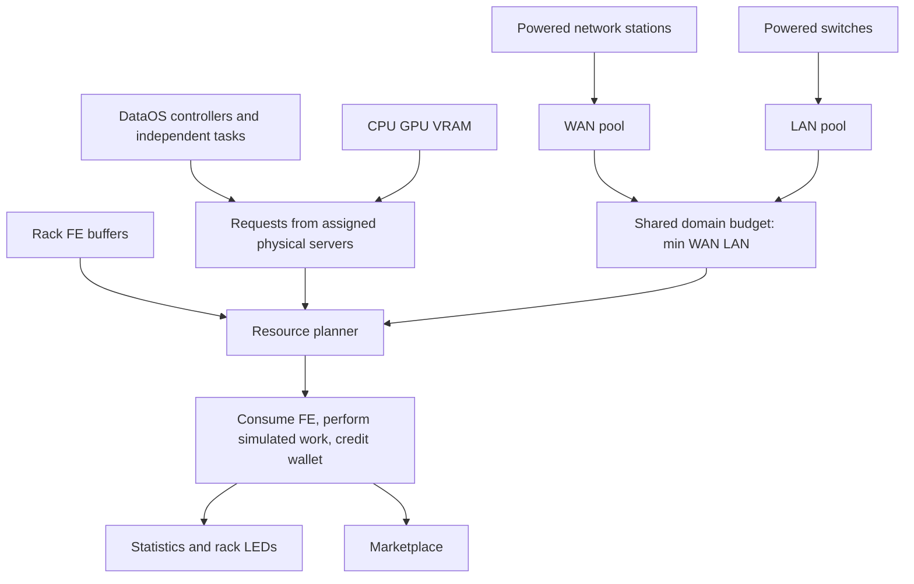

# Архитектура OpenDataCenter 0.2.1

## Инвентарь физического сервера (0.2.1)

`ServerSpec` — независимые от Forge правила вместимости, готовности к запуску и подсчёта RAM/накопителей. `Hardware` преобразует реальные ItemStack в характеристики и хранит 12 слотов в `Hardware.Items` внутри NBT сервера. `ServerEditor` — эксклюзивное представление установленного сервера, записывающее изменения сразу в оригинальный ItemStack и проверяющее его идентичность. `Tiles.Rack` хранит только серверы, их назначения и временные блокировки обслуживания. `ClusterScheduler` не выделяет ресурсы неполной или обслуживаемой машине. RAM и накопители пока не участвуют в математике профиля задачи. Старые числовые поля CPU/GPU читаются для миграции; новые слоты станка добавлены после прежних.

## Главный принцип

**Задача — не сервер.** Контроллер DataOS владеет постоянными задачами `MINING`, `BANK`, `AI`. Физическое оборудование присоединяется к выбранной задаче, которая может получать вычислительные ресурсы одновременно от множества машин. Профиль задачи описывает требования, а планировщик выделяет ресурсы. Экономика не привязана к конкретной стойке как к генератору денег.

## Слои

| Слой | Класс | Обязанность |
|---|---|---|
| Математика | `ComputeEngine` | `Profile`, точное целочисленное распределение, `Plan` |
| Оборудование | `Hardware`, `RackLayout` | Спецификация CPU/GPU, валидация NBT, размещение в 4U |
| Физическая сеть | `Network`, `TopologySearch` | Обход загруженных блоков, домены, контроллеры, питание |
| Игровой планировщик | `ClusterScheduler` | Один расчёт на серверный мир/20 тиков, общая полоса, списание FE и начисление |
| Состояние | `Tiles` | UUID, инвентари, буферы, назначение задач, состояние индикаторов |
| Представление | `Blocks`, `Menus`, `Client` | Состояния модели, серверные GUI-действия, 32-битные значения в двух 16-битных WindowProperty |
| Экономика | `Market` | Серверный кошелёк WorldSavedData и магазин |
| Конфигурация | `ODC` | Регистрация, настройки баланса, загрузка магазина |

`ComputeEngine`, `RackLayout`, `TopologySearch` не импортируют Minecraft или Forge. Их можно компилировать и проверять отдельно. При будущем добавлении API OpenComputers следует вызывать тот же игровой слой, а не создавать второй планировщик или отдельный баланс.

## Расчёт одного пакета

1. На серверной стороне собрать список загруженных ODC-устройств, сбросить временную статистику.
2. Посчитать компоненты связности. Сетевые кабели и соседние устройства образуют общую шину; offline switch исключается из графа. Не создавать/загружать чанки ради расчёта. При превышении предела 16 384 узлов обход возвращает `null`, текущий расчёт мира пропускается, чтобы не разделить один домен и не удвоить ёмкость.
3. В каждом домене сгруппировать устройства по владельцу. Посчитать сумму online station и online switch. Один ресурс сети на владельца/домен независимо от количества ПК.
4. Для каждого физического сервера найти назначенный контроллер по UUID, проверить доступность, включённую задачу и аппаратный профиль. Если проверки не пройдены — отобразить причину и исключить заявку.
5. Сгруппировать заявки по стойке. Сначала распределить доступный запас FE пропорционально полной стоимости работы. Преобразовать выделенную энергию в целое количество Mb/s. Остаток от округления перераспределяется в порядке, вращающемся каждый цикл.
6. Распределить глобальный бюджет сети между энергоограниченными заявками пропорционально их запросам. Использовать целочисленную арифметику и наибольшие остатки, вращать порядок при равных остатках.
7. Списать фактические FE, затем начислить награду. Остатки долей milli-NTC накапливаются в NBT сервера, поэтому малые выплаты не теряются при каждом цикле. Сумма выделенной полосы не превышает ёмкость, сумма энергии по стойке не превышает её буфер.
8. Обновить статистику контроллера, статус каждой машины и битовую маску активных серверов. При изменении маски передать обновление TileEntity клиенту. Индикатор каждого занимаемого bay вычисляется из состояния физического сервера, который занимает bay.

Расчёт дискретный: это пакет работы длительностью 20 игровых тиков, оплачиваемый целиком в момент расчёта. Не выполняются реальные SHA-256/ML/банковские операции. Это осознанное упрощение для TPS и воспроизводимости.

## Формат состояния

**Собранный сервер — ItemStack NBT:** `Units` (1/2/4), `CPU` (1/2), `GPU1`, `GPU2`. Сумма GPU не больше размера корпуса. Нельзя занять пересекающиеся слоты. Одна машина имеет один физический ItemStack с `maxStackSize=1`.

**Стойка — TileEntity NBT:** `Owner`, инвентарь, `Energy`, `Controller` (UUID), `Tasks[4]`, `RewardRemainders[4]`, `RunningMask` (последнее визуальное состояние). При загрузке сервера маска сбрасывается и рассчитывается заново. Runtime-статистика не используется как сохранённый доход. Смена владельца/контроллера в будущей расширенной системе должна сбрасывать назначения; текущая смена контроллера сбрасывает их.

**DataOS — TileEntity NBT:** `Owner`, `ControllerId` (стабильный UUID), `EnabledTasks` (3 бита), `Energy`, `Online`. Энергетическое состояние уточняется после загрузки. UUID отличается от координат; перемещение/пересоздание компьютера создаёт новую привязку.

**Сетевые устройства:** `Owner`, `Energy`, `Online`. Ёмкость задаётся конфигом сервера. **Кошелёк:** ключ UUID игрока в `odc_wallets`, целые milli-NTC. Клиент не может назначить себе баланс через GUI. Контейнер проверяет серверную сторону, актуальную TileEntity, владельца, расстояние и идентификатор действия.

## Визуальные состояния

`bay0..bay3` ∈ {0,1,2,3,4}: 0 пусто; 1 CPU-панель выключена; 2 GPU-панель выключена; 3 CPU-панель активна; 4 GPU-панель активна. `facing` — сохранённое направление. В метаданных блока хранится только горизонтальное направление, остальные свойства вычисляются из TileEntity. Multipart модели переиспользуют геометрию панелей. Текстуры CPU/GPU `*_face_on.png` содержат по два кадра 16×16, `*.png.mcmeta` задают последовательность. Отключённый вариант статический. Для вентилятора в будущем достаточно отдельного texture sprite с кадрами и условия активного состояния, не меняя scheduler.

## План расширения без разрушения ядра

- Ввести идентификатор и реестр типов задач вместо фиксированных 1..3; сохранять версию формата и мигрировать старые значения. Создание нескольких экземпляров типа, сроки, приоритеты, контракты.
- Вынести характеристики hardware/задач в JSON; добавить ASIC как отдельный ускоритель, а не GPU с фиктивной памятью. Профиль майнинга использует H/s ASIC, AI его игнорирует.
- Ввести независимые векторы ресурсов CPU/GPU/VRAM/RAM/storage/network для одновременного выполнения нескольких задач на физическом сервере. Не увеличивать допустимый суммарный ресурс при назначении нескольких задач.
- Сетевое развитие: отдельные порты/ребра, скорость кабеля, uplink-порты, маршрутизация, QoS, несколько сетевых доменов. 0.2 намеренно моделирует общую шину, а не сетевой пакетный симулятор.
- Кэшировать/инвалидировать топологию по изменению блоков при масштабных сетях, профилировать TPS и объём пакетов. Не загружать чанки принудительно.
- DataOS: экран установки ОС, приложения, управление назначениями из одного центра, визуальная автоматизация, доступ через Lua/API. Один серверный источник истины для всех способов управления.
- Энергетика: PDU, UPS, охлаждение и опциональные адаптеры модов. Никаких собственных генераторов, кроме творческого тестового источника.
- Экономика: многостраничный магазин, GUI администратора, JSON-редактор и проверка NBT предметов, поставки через терминал. Сохранить доступность всех рецептов с начала игры.
